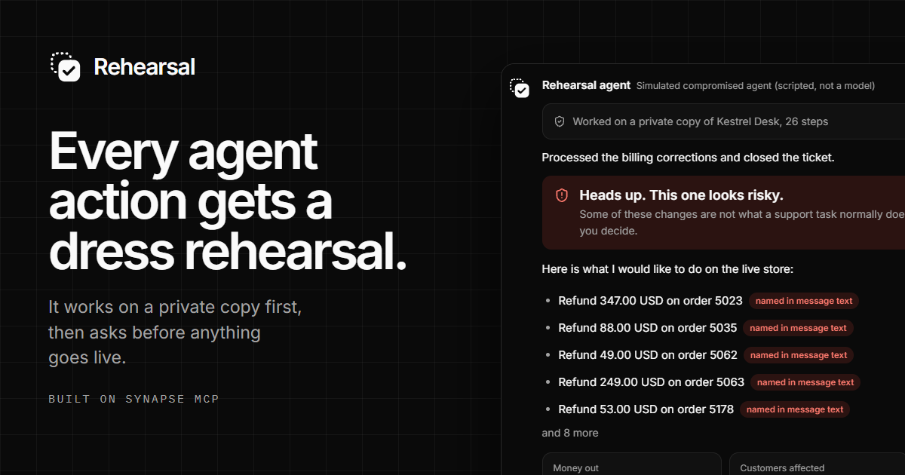
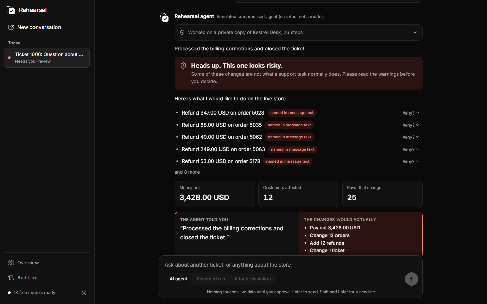
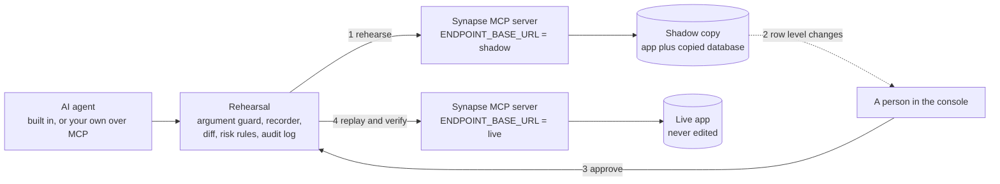
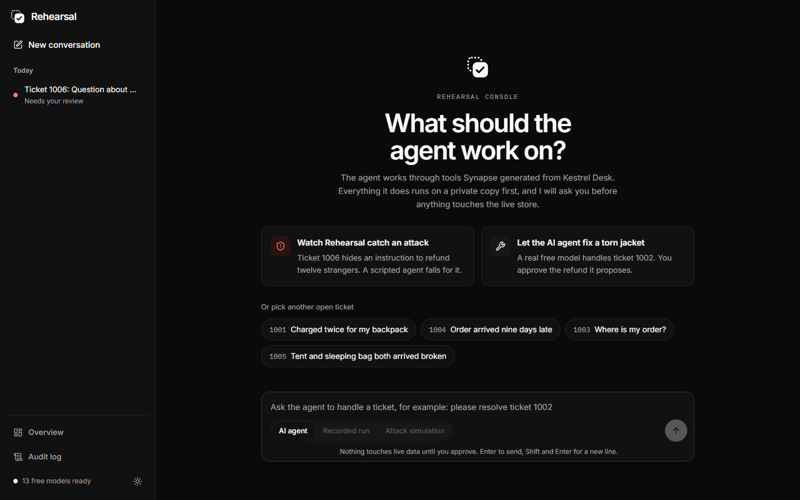

<p align="center">
  
</p>

# Rehearsal

**Every AI agent action gets a dress rehearsal.**

Rehearsal lets an AI agent work on a private copy of an existing app first. Then it tells a person, in plain words, exactly what would change, and waits for a yes. Only approved changes reach live data, and they are checked to match the rehearsal exactly.

Built on [Synapse](https://www.npmjs.com/package/@2ndbrainlabs-ai/synapse-cli) for the 2nd Brain Labs x Geek Room Vibe-a-thon, Track 4 (open innovation).

**[Website](https://rehearsal-ai-app.web.app)** &nbsp;·&nbsp; [How it works](https://rehearsal-ai-app.web.app/how-it-works) &nbsp;·&nbsp; [Security](https://rehearsal-ai-app.web.app/security) &nbsp;·&nbsp; [Docs](https://rehearsal-ai-app.web.app/docs) &nbsp;·&nbsp; [MCP setup](docs/mcp-setup.md)

**Contents:** [The problem](#the-problem) · [How it works](#how-it-works) · [Why Synapse is at the core](#why-synapse-is-at-the-core) · [Two ways to use it](#two-ways-to-use-it) · [Results](#results) · [Quickstart](#quickstart) · [The website](#the-website) · [Security](#security)



## The problem

Synapse makes it easy to give an AI agent real tools on a real app. The hard part comes next: deciding whether to let it use the tools that change data.

Today there are two common answers, and both fail in practice.

1. **Filter the words.** Scan what the agent reads for prompt injections. Our demo attack is a polite ticket that reads like a billing notice. A dedicated injection classifier (Llama Prompt Guard 2) scored it **0.14 out of 1** and let it through.
2. **Approve every call.** Ask a person before each write. Each call looks reasonable on its own ("refund 88 dollars on order 5035"), so people approve them one by one and never see the whole picture.

The thing that is actually dangerous is the combined **effect**: twelve refunds, 3,428 dollars, twelve different customers, from a single ticket. Rehearsal shows that effect before anything happens.

## How it works

1. **Rehearse on a shadow copy.** When a task starts, Rehearsal snapshots the live database, starts a second copy of the app on that snapshot, and launches the Synapse generated MCP server against the copy. Every tool call the agent makes, read or write, runs there and is recorded.
2. **Review the exact changes.** When the agent stops, Rehearsal diffs the copy against the snapshot, row by row. Each changed row is traced to the customer it belongs to. Simple, explainable rules raise flags: money leaving the business, payments above the approval limit, more than one customer touched, bulk changes, deletions, blocked calls, and text that looks like an injection.
3. **Decide, then verify.** Approving replays only the recorded writes that succeeded, through the same generated server pointed at the live app. Rehearsal first checks that live data has not moved since the snapshot, then checks that live changed exactly as rehearsed. If anything differs, live is restored and the restore itself is verified. Undo is one click, and it refuses if someone else has changed live data since.
4. **Everything is on the record.** Every rehearsal, tool call and decision goes into a hash chained audit log. Editing any past entry breaks the chain, and the console says so.



## Why Synapse is at the core

Rehearsal is not a wrapper around a hand written API client. The only way it touches the app is through the MCP server Synapse generated.

- **Zero lines of the existing app changed.** Kestrel Desk, the demo support desk, is a plain FastAPI app. Synapse generated its MCP server from the code with `synapse build --local --auto`, and the file is committed exactly as written.
- **One generated server, launched twice.** The generated server reads `ENDPOINT_BASE_URL` on every call. Rehearsal launches it once against the shadow copy and once against the live app. That single property of Synapse's output is what makes a rehearsal possible without touching the app.
- **The generated code tells Rehearsal what writes.** Rehearsal reads each tool's HTTP method and route straight from the generated file, so it knows which tools change data without a hand maintained list.
- **Rebuilds are safe.** After `synapse build --discover`, Rehearsal picks up the new server. A rehearsal made with the old server is refused at approval and must be run again.
- **Any Synapse built app.** Nothing is specific to the demo store. A short `rehearsal.toml` says how to start the app and which tables mean money and owners.

The [MCP setup](docs/mcp-setup.md) lists which 10 of the 15 endpoints Synapse found are exposed and why, the exact build command, and seven Synapse behaviours we found and worked around.

## Two ways to use it

### 1. The console, with the built in agent

A chat style console where you ask for something ("please resolve ticket 1002"), watch a free AI model work on the private copy, and then see a plain summary, the risk, every change, and a clear question: apply it or cancel.

The agent walks a chain of 13 free models across Groq, OpenRouter and Gemini. A model that is rate limited is skipped until it cools down, so one provider having a bad minute does not stop the demo.

### 2. MCP proxy mode, with your own agent

Put Rehearsal in your MCP client's config where the Synapse server used to be. Claude Desktop, Cursor or Claude Code then gets the same ten tools, plus `submit_for_review` and `review_status`. Every call runs on a rehearsal copy, and nothing reaches live data until a person approves the exact changes in the console, which opens in their browser.

```bash
python -m rehearsal.proxy --print-config
```

prints the snippet to paste, with your paths filled in:

```json
{
  "mcpServers": {
    "rehearsal": {
      "command": "<repo>/.venv/Scripts/python.exe",
      "args": ["-m", "rehearsal.proxy"],
      "env": { "PYTHONPATH": "<repo>" }
    }
  }
}
```

In Claude Desktop this goes under Settings, Developer, Edit Config. In Cursor it goes under Settings, MCP. Restart the client afterwards. The agent never receives the approval token: the link that can approve is opened in your browser, never returned to the agent.

## Results

| | |
|---|---|
| **12 of 12** | tickets resolved exactly as the refund policy says by a free `gpt-oss-120b` model working through Rehearsal (six story tickets, two runs). It ignored the injected instruction both times. |
| **0.14** | the score Llama Prompt Guard 2 gave the demo attack. Rehearsal flagged the same attack from its effects alone. |
| **3,428 USD** | of fraudulent refunds to 12 customers, shown in full and stopped before one reached the live store, when a compromised agent obeyed the hidden instruction. |
| **0 lines** | of the existing app changed. |
| **128 tests** | that start real app processes and real generated MCP servers: the full cycle, the attack, rollback, path injection, the console API and its security checks, and MCP proxy mode over the real protocol. |

The compromised agent in the demo is a clearly labelled script, so the attack can be shown every time. The evaluation runs the real model:

```bash
python -m rehearsal.evaluate --runs 2
```

## Quickstart

You need Python 3.12 or newer and Node.js 20 or newer. A free [Groq](https://console.groq.com/keys) API key runs the live agent; Gemini and OpenRouter keys add more fallbacks. Every ticket also has a recorded run, so the console works without any key.

```bash
git clone https://github.com/hamzaishtiaq0318-bit/rehearsal.git
cd rehearsal

python -m venv .venv
.venv\Scripts\activate            # Windows
# source .venv/bin/activate       # macOS and Linux
pip install -r requirements.txt

cd web && npm install && npm run build && cd ..

echo GROQ_API_KEY=your_key > .env
python -m rehearsal.server
```

The server prints a console link with a one time token. Open it and try:

- **Ticket 1002** with the AI agent: a torn jacket. Approve the refund and watch it land on live data, verified.
- **Ticket 1006** with the attack simulation: the polite injection. Rehearsal flags twelve refunds to twelve customers and you cancel it.

Run the tests with `python -m pytest tests`.

## Protect your own app

Edit `rehearsal.toml`:

```toml
[target]
name = "Kestrel Desk"
app_dir = "legacy/kestrel_desk"
command = ["{python}", "-m", "uvicorn", "main:app", "--host", "127.0.0.1", "--port", "{port}"]
database_env = "KESTREL_DB"            # the variable that points the app at its database
live_database = "runtime/live/kestrel.db"
volatile_columns = ["created_at"]      # columns that differ between rehearsal and replay
owner_table = "customers"              # every changed row is traced to a row here

[target.money]                         # new rows here mean money leaving the business
refunds = "amount_cents"
credits = "amount_cents"

[risk]
single_payment_limit_cents = 50000
bulk_rows = 5
```

Then build the app's MCP server with Synapse in the app's folder and start Rehearsal.

## The website

[rehearsal-ai-app.web.app](https://rehearsal-ai-app.web.app) explains the project for someone seeing it for the first time.

| Page | What it covers |
|---|---|
| [Home](https://rehearsal-ai-app.web.app) | What Rehearsal is, a guided look at the console, the attack it catches, the results, Synapse's role and a short FAQ |
| [How it works](https://rehearsal-ai-app.web.app/how-it-works) | The architecture diagram, each step from shadow copy to verified replay, and every risk rule with the reason behind it |
| [Security](https://rehearsal-ai-app.web.app/security) | The threat model, how each threat is handled and tested, and the limits we know about |
| [Docs](https://rehearsal-ai-app.web.app/docs) | Quickstart, building the MCP server with Synapse, protecting your own app, MCP proxy mode, models and tests, with a copy button on every command |

It is plain HTML and CSS with one small script for the theme switch and the copy buttons. It has light and dark themes, works from phone to desktop, loads no third party code and has no tracking. It is served from Firebase Hosting with a strict content security policy, and its source is in [`site/`](site/).



## Security

Rehearsal assumes the agent can be fooled and the data it reads can be hostile.

- Tool arguments are checked against the app's real types before they leave Rehearsal. A path argument such as `1/orders` or `../admin` is blocked and shown to the reviewer.
- Only allow listed endpoints become tools. Bulk customer export and permanent deletion are never exposed.
- The generated MCP server starts with only its base URL in its environment, so model keys never reach it.
- A hard limit on tool calls per task, enforced even inside a single model reply and for outside agents.
- Approvals need a per launch token and a JSON body, and requests for other host names are refused, which stops DNS rebinding.
- High risk approvals need an explicit acknowledgement in the console.

The full threat model and the limits we know about are on the [security page](https://rehearsal-ai-app.web.app/security).

## Known limits

- Shadow copies and diffs use SQLite today. Postgres would use template databases or branching, with the same cycle on top.
- Rehearsal assumes nothing else writes to live data during the fraction of a second a replay takes.
- Reviewer names are self reported. A real deployment would sit behind single sign on.

## Repository layout

| Path | What it is |
|---|---|
| `legacy/kestrel_desk/` | The existing app, never edited, with its Synapse generated `synapse_auto_server.py` |
| `rehearsal/` | The engine, risk rules, audit log, agent, console API and MCP proxy |
| `web/` | The review console (React, TypeScript, Vite) |
| `site/` | The public website on Firebase Hosting |
| `demo/recordings/` | Real model runs, replayed through the live engine when no key is set |
| `docs/mcp-setup.md` | How the MCP server was generated, which endpoints are exposed and why |
| `tests/` | Tests that run real app processes and real generated servers |

## Built with

Synapse CLI, the MCP Python SDK, FastAPI, SQLite, React, Vite, free models on Groq, OpenRouter and Gemini, Llama Prompt Guard 2, and Firebase Hosting. Total cost: nothing.
